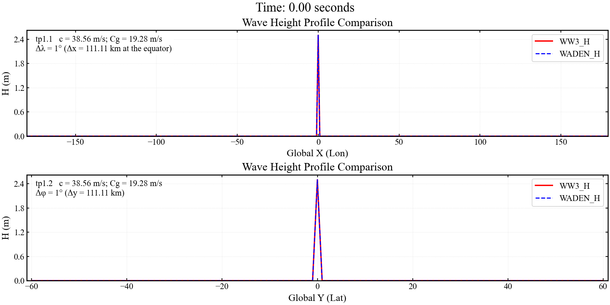
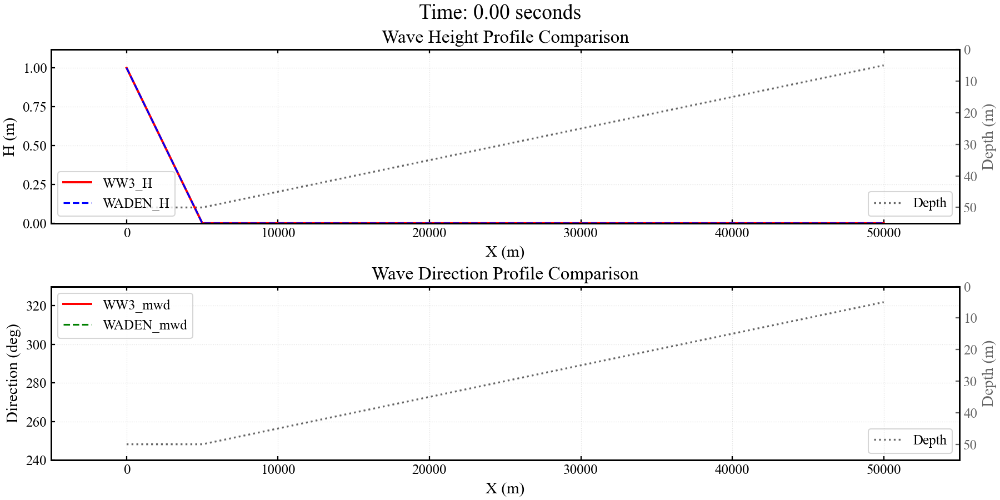
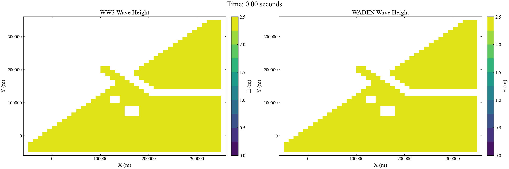

# WADEN: Differentiable Wave Dynamics in JAX

**WADEN** is a JAX dynamical core for ocean-wave modelling. It evolves
directional wave spectra on spherical and Cartesian grids and accepts
external source terms for physical and hybrid neural wave models.

- **Wave dynamics:** dispersion, spatial propagation, depth-induced refraction,
  boundary conditions and Garden Sprinkler Effect alleviation.
- **Neural parameterizations:** couple a learned source term to the dynamics
  and differentiate a forecast objective with respect to network parameters.
- **JAX execution:** use `jit`, `grad` and `jvp` on CPU or GPU, with JAX and
  NumPy as the core runtime dependencies.

## Wave propagation and refraction



**Figure 1. One-dimensional propagation on spherical grids (WW3 tp1.1 and
tp1.2).** Wave-height profiles for an eastward packet along the equator
(top) and a northward packet along a meridian (bottom), over a uniform
2500 m depth. At the initial peak frequency of 0.040469 Hz, phase and group
speeds are approximately 38.56 and 19.28 m/s. The 1° grid spacing corresponds
to 111.11 km along each propagation path. Red solid lines show WW3; blue
dashed lines show WADEN.



**Figure 2. Depth-induced refraction (WW3 tp1.4).** Wave-height (top) and
mean wave-direction (bottom) profiles as waves propagate over a bottom
shoaling from 50 to 5 m across 50 km. Grey dotted curves show the water
depth on the right-hand axes, increasing downward. Wave direction uses
the coming-from convention. WW3 profiles are red; WADEN profiles are blue
for wave height and green for direction. An open downstream boundary lets
outgoing wave energy leave the domain. The animation covers the first 18000 s.



**Figure 3. Two-dimensional Cartesian propagation (WW3 tp2.1).** A wave
field propagates obliquely through an irregular domain with prescribed
incoming spectra. WW3 (left) and WADEN (right) show the evolution of
significant wave height using a common colour scale.

The [WW3 example guide](examples/ww3/README.md) provides the reference data,
reproduction commands and quantitative comparisons for all four cases.

## Installation

From the WADEN project directory (or an unpacked source distribution):

```bash
python -m pip install .
```

Requires Python 3.10+, JAX 0.6.2–0.6.x and NumPy 2.x. For NVIDIA GPUs,
follow the [JAX installation guide](https://docs.jax.dev/en/latest/installation.html)
to install accelerator support for your environment.

## Examples

**Physical propagation.** Prepare an NPZ wave field using the
[input-array format](USER_GUIDE.md#input-arrays), then advance its spectrum:

```bash
python examples/physical_step.py input.npz output.npz
```

Use `--steps N` for a stationary, zero-source rollout of `N` 600-second steps.

**Neural source coupling.** The [JAX MLP example](examples/neural_source.py)
connects a source network to the dynamics, differentiates a spectral loss
and performs one parameter update. It uses a synthetic target to illustrate
the workflow. After running tp1.1 from the WW3 guide:

```bash
python examples/neural_source.py outputs/ww3/tp1_1/initial_arrays.npz
```

**Parameter recovery.** The [source-coefficient example](examples/recover_source_scale.py)
recovers a known source strength from synthetic observations on the supplied wave field:

```bash
python examples/recover_source_scale.py outputs/ww3/tp1_1/initial_arrays.npz
```

See the [user guide](USER_GUIDE.md) for the array format, `step` and `rollout`
interfaces, source-term integration and differentiation assumptions.

## License

WADEN is developed as part of [NeuralSWM](https://github.com/GaryYang77/NeuralSWM)
and is released under the [MIT License](LICENSE).
